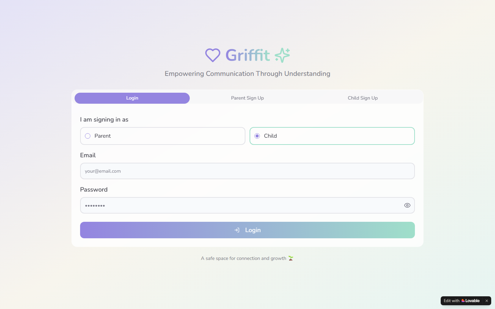
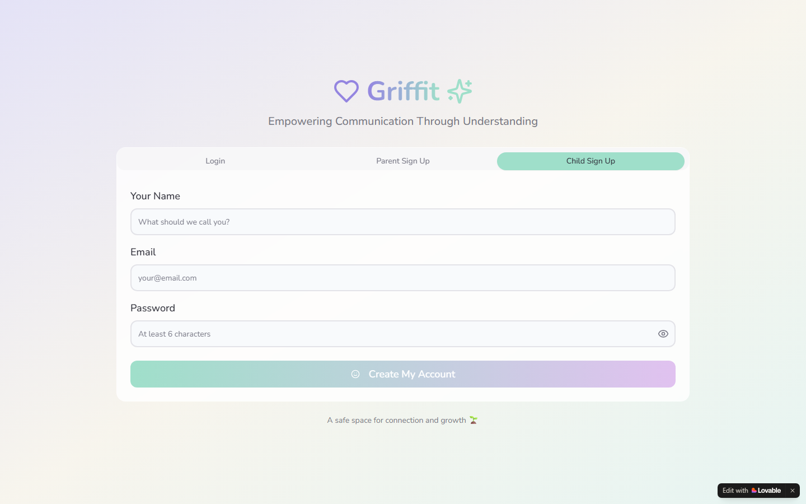

# Griffit

A calm, autism-friendly web app where a child shares feelings and does small activities, and a linked parent sees a summary and sends encouragement.

**Live site:** https://griffit-buddy-connect.lovable.app



## What it does

- **Two kinds of account.** Parents and children sign up separately and choose their role when they log in. Each role has its own dashboard, and the home page sends a signed-in user to the right one.
- **Linking by email.** A parent enters a child's email, or a child enters a parent's email, to connect the two accounts.
- **Feelings and calm.** The child picks one of five feelings (happy, calm, excited, okay, sad), and can visit the Calm Corner to choose a calming scene and count three deep breaths.
- **Choices and drawing.** The Choice Explorer lets the child pick foods, with a filter by texture. The Creative Expression Hub is a drawing canvas with eight colours, a brush size, an eraser, and buttons to save or download the picture.
- **Progress garden.** Every activity is logged, and each one adds a flower to the child's garden, up to twenty.
- **Parent dashboard.** For each linked child the parent sees today's counts (feelings shared, Calm Corner visits, total activities), the feelings logged over the past seven days, and a form to send a badge with a short message. The message appears in the child's Encouragement Inbox.



Both dashboards require an account, so the screenshots show only the public screens.

## How it is built

| Part | Technology |
| --- | --- |
| UI | React 18.3, TypeScript 5.8 |
| Build tool | Vite 5.4 |
| Components | shadcn/ui (Radix UI), lucide-react icons |
| Styling | Tailwind CSS 3.4 |
| Routing | React Router 6.30 |
| Backend | Supabase (auth and Postgres) through `@supabase/supabase-js` 2.75 |
| Local mocks | MSW 1.2 |

Routes are defined in `src/App.tsx`: `/` (redirect), `/auth`, `/child-dashboard` and `/parent-dashboard`, with pages in `src/pages/`. The dashboard cards live in `src/components/child/` and `src/components/parent/`, the sign-in forms in `src/components/auth/`, and the linking card in `src/components/linking/LinkByEmailCard.tsx`. The Supabase client is in `src/integrations/supabase/client.ts`. The tables, row-level security policies and the two linking functions are in `supabase/migrations/`.

## Run it locally

You need Node.js and npm.

```sh
git clone https://github.com/anipiro/Griffit.git
cd Griffit
npm install
cp .env.example .env
npm run dev
```

The dev server runs on http://localhost:8080.

Set these in `.env` (see `.env.example`):

- `VITE_SUPABASE_URL` – the URL of your Supabase project
- `VITE_SUPABASE_PUBLISHABLE_KEY` – its publishable (anon) key
- `VITE_USE_MOCKS` – set to `true` to start the MSW mocks in `src/mocks/`. They only fake sign-up and sign-in, so the dashboards still need a real database.

Without the two Supabase values the app shows a configuration error instead of the login screen.

To run against a local Supabase stack instead, install Docker Desktop and the Supabase CLI (`npm install -g supabase`), then run:

```sh
npm run dev:local
```

This starts `supabase start` and the Vite dev server together.

Other scripts: `npm run build`, `npm run preview`, `npm run lint`.

## Credits

Built with [Lovable](https://lovable.dev) as a hackathon project.
